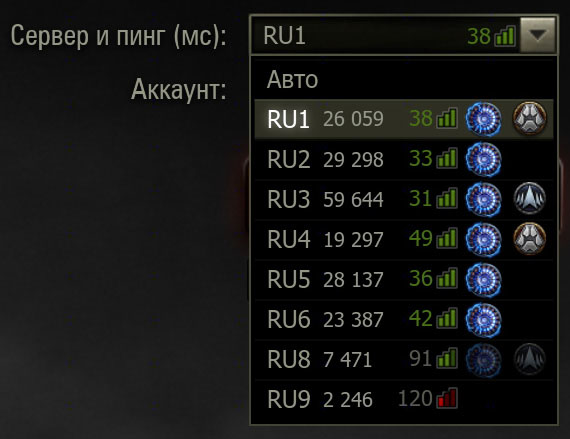
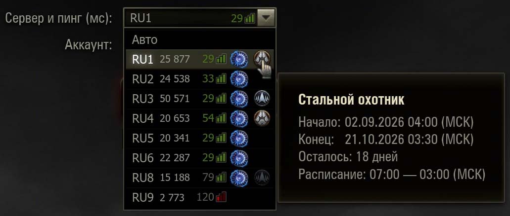
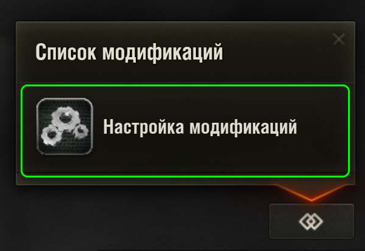
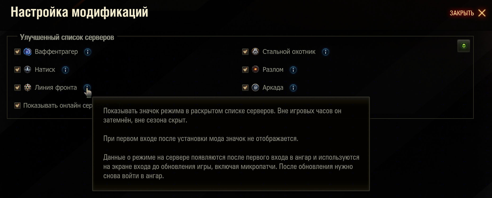

# Улучшенный список серверов

**Версия 1.0.2 · «Мир танков» · Автор: NIDIN**

Онлайн RU-серверов, значки игровых режимов и расписания в раскрытом списке выбора сервера.

**[Скачать мод](https://github.com/xNIDINx/improved-server-list/releases/latest)** · [Моды на nidin.ru](https://nidin.ru/mods)

## Возможности

1. Онлайн RU-серверов.
2. Значки семи игровых режимов: Ваффентрагер, Натиск, Линия фронта, Стальной охотник, Разлом, Аркада и **Укрепрайон: сражения**.
3. Расписания боёв по наведению на значок режима. Время указано по Москве.
4. Все функции мода настраиваются: любую можно включить или отключить.

Значки и онлайн видны только в раскрытом списке. Пинг и совместимые сочетания значков выравниваются по столбцам. Список расширяется при необходимости, закрытая кнопка сохраняет штатную ширину.

## Установка

Обязательно установите оба мода отдельно:

- **[ModsList API](https://gitlab.com/wot-public-mods/mods-list)** — «Меню с установленными модами».
- **[ModsSettingsAPI](https://github.com/izeberg/modssettingsapi)** — «Настройки модов в игре».

Они также доступны в [каталоге nidin.ru](https://nidin.ru/mods) и не входят в пакет этого мода.

1. Закройте игру.
2. Скачайте файл `.mtmod` из [последнего релиза](https://github.com/xNIDINx/improved-server-list/releases/latest).
3. Удалите предыдущий файл этого мода и поместите новый без распаковки в `mods/<текущая версия игры>/`.
4. Запустите игру. Для получения данных об остальных режимах войдите в ангар; календарь Укрепрайона загружается отдельно уже при запуске.

Архивы GitHub «Source code» для установки не нужны. После патча проверяйте наличие обновлений мода.

## Настройки

Откройте **«Список модификаций» → «Настройки модификаций» → «Улучшенный список серверов»**. Настройки также доступны на экране входа через ModsSettingsAPI.

При первой установке включены все семь режимов и онлайн. Сохранённый выбор при обновлении не сбрасывается. «Применить» и «ОК» сохраняют изменения, «Отменить» и Esc отменяют их.

Скриншоты иллюстрируют интерфейс и могут отличаться от текущей версии.

## Расписание и доступность

Данные шести основных режимов появляются после первого входа в ангар и сохраняются между запусками. После патча или микропатча нужно снова войти в ангар.

Для **Укрепрайона** используется официальный календарь Вылазок и Наступлений. При запуске мод обновляет его, если с успешной загрузки прошло 24 часа. Повторные запуски используют сохранённое расписание; во время игры дополнительных запросов календаря нет. При ошибке загрузки сохранённые данные действуют до двух суток, затем значок скрывается.

Вне игровых часов значки затемнены; при отсутствии действующих данных скрыты. Недоступные значения онлайна не заменяются нулём. Отключение соответствующей функции прекращает её запросы.

## Файлы и условия распространения

Готовый пакет и `SHA256SUMS.txt` находятся в [релизах](https://github.com/xNIDINx/improved-server-list/releases). Репозиторий содержит собственные исходники Python и ActionScript, метаданные и изображения; игровые SDK и инструменты сборки в него не входят.

Автор — **NIDIN**. Разрешено использовать мод, менять предусмотренные настройки и распространять неизменённые копии с сохранением авторства и условий. **Изменение кода и распространение изменённых версий требуют разрешения автора.** [Полный текст условий](LICENSE) также включён в `.mtmod`. Права на игровые ресурсы и сторонние компоненты остаются у их правообладателей.
